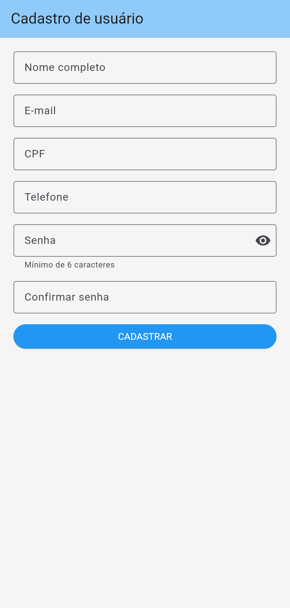
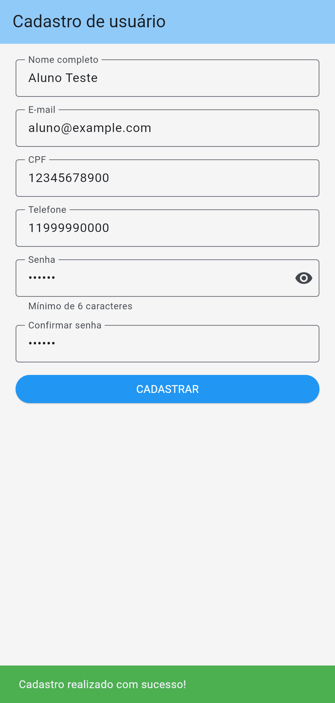
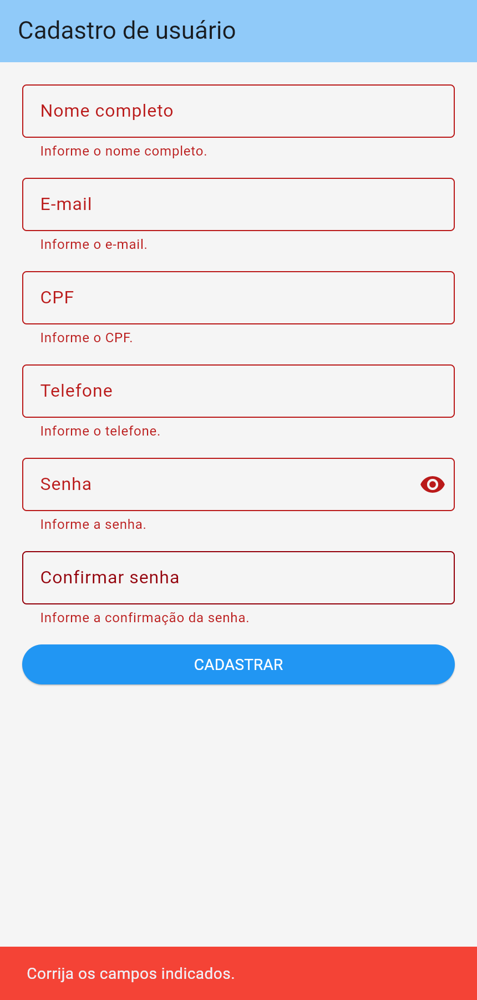

# Cadastro de usuário em Flutter

Atividade prática de Desenvolvimento Mobile: formulários e validações em Flutter e Dart.

**Aluno:** Eduardo Fernandes Habib Vieira

**RA:** 2310935

## O que foi implementado

- Nome completo, e-mail, CPF, telefone e senha obrigatórios.
- CPF e telefone com teclado adequado e filtro que permite somente números.
- Senha com no mínimo 6 caracteres.
- Erros individuais abaixo dos campos ao tocar em **CADASTRAR**.
- SnackBar verde quando os dados são válidos.
- Desafios: confirmação de senha, botão de mostrar/ocultar, e-mail validado com `RegExp` e SnackBar vermelho para dados inválidos.
- Rolagem para acomodar telas pequenas e o teclado, com margens de 20 pixels e espaçamento de 16 pixels.

A implementação está em [lib/main.dart](lib/main.dart), sem pacotes externos de execução. O cadastro é demonstrativo: captura os dados em memória com `FormState.save()`, sem servidor ou banco de dados. O CPF e o telefone seguem a regra solicitada de aceitar apenas números; não há verificação de tamanho ou dígitos verificadores de CPF.

## Estrutura dos widgets

```text
Scaffold
└── Form(key: _formKey)
    └── SingleChildScrollView (padding: 20)
        └── Column
            ├── TextFormField (nome)
            ├── TextFormField (e-mail)
            ├── TextFormField (CPF)
            ├── TextFormField (telefone)
            ├── TextFormField (senha)
            ├── TextFormField (confirmação de senha)
            └── ElevatedButton (CADASTRAR)
```

## Executar

Requisitos: Flutter SDK com Dart, Git e um navegador. Para Android, também são necessários JDK 17 e Android SDK. Consulte a [instalação oficial do Flutter](https://docs.flutter.dev/install) e a [configuração Android](https://docs.flutter.dev/platform-integration/android/setup).

```powershell
git clone https://github.com/eduardofhabib/atividade-flutter-cadastro-usuario.git
cd atividade-flutter-cadastro-usuario
flutter pub get
flutter run -d web-server --web-hostname 127.0.0.1 --web-port 8080
```

Abra `http://127.0.0.1:8080` no Navegador. O [modo web-server](https://docs.flutter.dev/platform-integration/web/setup) permite executar o Flutter no navegador escolhido. No computador da atividade, o script `executar_brave.ps1` também inicia o formulário:

```powershell
powershell -ExecutionPolicy Bypass -File .\executar_brave.ps1
```

Para um celular Android conectado por USB, com a depuração USB ativada:

```powershell
flutter devices
flutter run -d ID_DO_DISPOSITIVO
```

## Verificar e compilar

```powershell
flutter analyze
flutter test
flutter build web
flutter build apk --debug
```

Os testes verificam campos obrigatórios, e-mail inválido, senha curta, confirmação diferente, filtros numéricos, visibilidade das senhas, sucesso e rolagem com o teclado aberto.

O APK de demonstração é gerado em `build/app/outputs/flutter-apk/app-debug.apk`.

O APK pronto para instalar está disponível na [versão de entrega](https://github.com/eduardofhabib/atividade-flutter-cadastro-usuario/releases/tag/v1.0.0).

## Prints para a entrega

O [PDF final](docs/Atividade_Formulario_Cadastro_Final.pdf) contém a identificação do aluno, os prints e o código utilizado, seguindo a organização da referência fornecida.







Use o link deste repositório e o arquivo `docs/cadastro_sucesso.png` na entrega pelo AVA.
